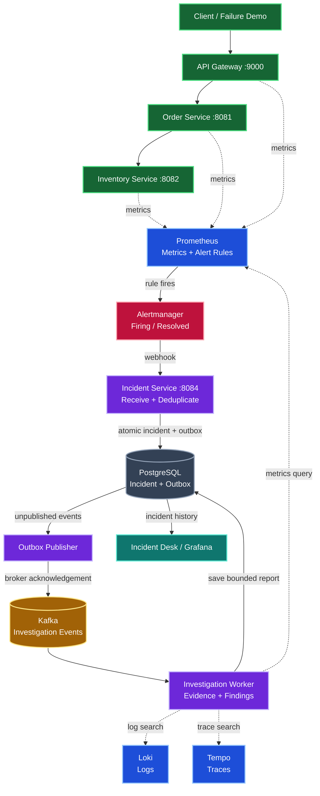

# Event-Driven Incident Observability

**Java 25 · Spring Boot · Kafka · PostgreSQL · Prometheus · Alertmanager · Loki · Tempo · Grafana**

> **Problem:** When an API slows down or fails, an alert alone doesn't explain what happened. Engineers have to search several dashboards for logs, request metrics and traces. Duplicate alerts and a crash between saving an incident and publishing its investigation work can also cause missed or repeated processing.

This project **detects service failures, persists incidents reliably, assembles a bounded evidence report, and tracks recovery**. It is a local, reproducible demonstration of event-driven incident handling—not a production monitoring replacement.

**[Quick start](#quick-start) · [Follow the code](#follow-the-code) · [Test a real alert](#test-a-real-failure) · [Failure scenarios](docs/failure-demos.md) · [Operations](docs/operations.md)**

## How it works



- **Metrics:** Actuator/Micrometer expose application metrics; Prometheus scrapes and evaluates latency, HTTP errors, uptime and connection-pool alert rules.
- **Events:** Alertmanager posts firing and recovery webhooks; the incident API deduplicates active alerts by fingerprint.
- **Durability:** Incident + outbox event are saved atomically; the publisher retries Kafka delivery until acknowledged.
- **Investigation:** A Kafka worker queries a limited telemetry window and stores a small, readable report. Partial telemetry outages become report warnings instead of pretending everything is healthy.
- **Recovery:** Resolved alerts close incidents; completed reports remain accessible. Incident data has explicit retention policies. The platform observes and explains; it does not automatically fix services.

## Repository structure

| Path | Responsibility |
| --- | --- |
| `api-gateway/` | Routes client requests and serves the Incident Desk UI (no separate frontend container) |
| `order-service/`, `inventory-service/` | Instrumented sample workload and opt-in failure injection |
| `incident-service/` | Webhook ingestion, deduplication, transactional outbox, Kafka worker, evidence analysis and report API |
| `notification-service/` | Optional Kafka consumer and SMTP notification settings |
| `ops/observability/` | Prometheus alert rules, Alertmanager webhook, Loki, Tempo, Grafana provisioning |
| `ops/postgres/` | Creates local databases; Flyway migrations are owned by each service |
| `scripts/` | End-to-end smoke test, deliberate failure scenarios and browser UI checks |
| `docs/testing.md` | Detailed test steps, SMTP options, test command reference and troubleshooting |
| `docs/failure-demos.md` | Failure matrix, timings, safe cleanup and recovery behavior |
| `docs/operations.md` | Data retention, resource limits, deployment assumptions and known reliability gaps |
| `Dockerfile`, `docker-compose.yml`, `.env.example` | Lightweight Java images, complete local infrastructure, sample non-secret configuration |
| `pom.xml`, `mvnw*`, `.github/workflows/` | Multi-module Maven build, reproducible wrapper and CI/image publishing |

**No AI dependency exists on this branch.** The default Compose startup includes metrics,
alerts, logs, traces, databases, Kafka, the incident worker and both UIs.
Only SMTP delivery and Kafka UI have optional profiles.

## Follow the code

For the **actual incident-handling path**, read these files in order:

1. `incident-service/.../api/IncidentController.java` — receives Alertmanager webhooks; exposes incident read APIs.
2. `incident-service/.../service/IncidentService.java` — deduplicates fingerprints; atomically saves incident state and enqueues work through `OutboxService`.
3. `incident-service/.../service/OutboxPublisher.java` — publishes unpublished events to Kafka; only marks them published after a broker acknowledgement.
4. `incident-service/.../service/InvestigationWorker.java` — receives the Kafka event and coordinates investigation.
5. `incident-service/.../service/TelemetryEvidenceService.java` — queries Prometheus, Loki and Tempo for a bounded evidence window.
6. `incident-service/.../service/EvidenceIncidentInvestigator.java` — produces evidence-based findings and recommendations, not a proven root cause.
7. `incident-service/.../service/InvestigationResultService.java` — persists the report and enqueues optional notification work.

To trace the alert *before* these steps, inspect
`ops/observability/prometheus/alerts.yml` and
`ops/observability/alertmanager/alertmanager.yml`.
For recovery, follow the resolved-webhook path in `IncidentService`.
Then read `incident-service/src/test/` and run
[the smoke test](#verify-the-event-driven-pipeline).

## Quick start

**Requirements:** Git, Docker Desktop / Docker Engine with Compose v2, **at least 4 GB available to Docker**. No local JDK, Maven, Kafka or PostgreSQL installation is needed.

1. Clone the repository and create local configuration:

   ```bash
   git clone https://github.com/Abhay123abhi/event-driven-incident-observability.git
   cd event-driven-incident-observability
   ```

   PowerShell: `Copy-Item .env.example .env`  
   Linux/macOS: `cp .env.example .env`

2. Open `.env` and choose **your own** values for `POSTGRES_PASSWORD` and `GRAFANA_ADMIN_PASSWORD`.

3. Start the **complete observability stack**:

   ```bash
   docker compose config --quiet
   docker compose up --build -d --remove-orphans
   docker compose ps
   ```

   The first build downloads Java build dependencies and service images. Wait until the Java services report **healthy**.

4. Open these local addresses:

   | What | Where |
   | --- | --- |
   | Incident Desk (start here) | http://localhost:9000 |
   | Grafana dashboards | http://localhost:3000 |
   | Prometheus alerts | http://localhost:9090/alerts |
   | Alertmanager | http://localhost:9093 |
   | Incident API | http://localhost:8084/api/incidents?scope=all |

Ports bind to `127.0.0.1` by default. If port 5432 is taken, set `POSTGRES_PORT=5433` in `.env`. For detailed health checks, startup troubleshooting and email configuration, follow [the testing guide](docs/testing.md). Do not expose the demo endpoints publicly.

## Verify the event-driven pipeline

From **PowerShell** (Windows, or `pwsh` on other platforms):

```powershell
.\scripts\smoke-test.ps1
```

Expected output: `PASS: <incident-id> was investigated, deduplicated, and resolved.`

This test directly submits a synthetic webhook and verifies incident persistence, fingerprint deduplication, outbox → Kafka → worker → report, and resolution. **It does not validate the Prometheus alert threshold.** For that, run the failure scenario below.

## Test a real failure

1. Add `SPRING_PROFILES_ACTIVE=observability,demo` to `.env`, then recreate Inventory:

   ```bash
   docker compose up -d --build --force-recreate inventory-service
   ```

2. Seed the demo inventory row:

   ```bash
   docker compose exec postgres psql -U observe -d inventory_service -c "INSERT INTO t_inventory (sku_code, quantity) VALUES ('keyboard-001',25) ON CONFLICT (sku_code) DO UPDATE SET quantity=25;"
   ```

3. In **PowerShell**, generate controlled latency or errors:

   ```powershell
   .\scripts\failure-test.ps1 -Scenario latency
   # Or: .\scripts\failure-test.ps1 -Scenario errors
   ```

4. Inspect Prometheus alerts, the Incident Desk and Grafana. The demo script resets failure injection in `finally`. Allow the configured alert evaluation, grouping and recovery delays. See [failure scenarios](docs/failure-demos.md) for Kafka outages, missing telemetry, duplicate alerts, and downstream failures.

## Why these design choices?

| Challenge | Design choice | Limitation |
| --- | --- | --- |
| Database save succeeds but Kafka publish fails | **Transactional outbox** | At-least-once, not exactly-once |
| Alertmanager resends an alert | **Fingerprint deduplication + DB constraint** | No cross-fingerprint correlation |
| Investigation is slow | **Kafka consumer** keeps webhook intake fast | Backlogs require monitoring |
| Logs or traces are unavailable | **Partial report + collection notes** | Missing sources limit conclusions |
| Incidents grow indefinitely | **Bounded evidence, pagination, retention** | Open incidents need operator attention |
| Many services strain local Docker | **Alpine Java runtime + lightweight limits** | Full stack still needs adequate RAM |

The core incident-service combines webhook intake, transactional outbox publication, Kafka investigation and report APIs in **one container**; these are logical roles, not unnecessary separate services. Logs stay in Loki, traces in Tempo, metrics in Prometheus; only incident state, bounded evidence and pending outbox messages belong in PostgreSQL.

## Optional tools

Email notifications are separate from the default stack:

```bash
docker compose --profile email up --build -d notification-service
```

To actually send email, configure SMTP credentials in `.env` and enable sending in the Incident Desk. Email is off by default. Kafka UI is optional: `docker compose --profile tools up -d kafka-ui` (http://localhost:8086).

## Troubleshooting and shutdown

- `docker compose ps` — inspect startup and health state.
- `docker compose logs --tail=100 incident-service` — investigate worker/outbox issues.
- `docker stats --no-stream` — inspect actual local memory usage.
- `docker compose down` — stop everything **without deleting stored data**.
- `docker compose down -v` — **destructive**: remove local incident, Kafka and telemetry volumes.

More detail: [local testing](docs/testing.md), [failure injections](docs/failure-demos.md), and [storage/operational limits](docs/operations.md).

**Scope:** One local incident-service instance, no autonomous remediation or production HA. The platform demonstrates reliable incident processing; it does not claim exactly-once delivery or automatic root-cause proof.
